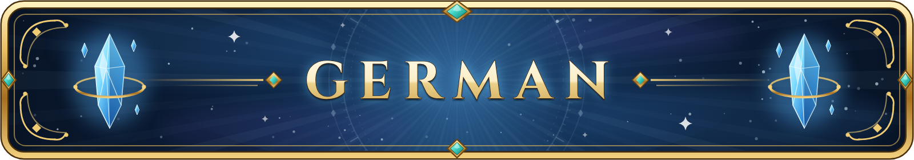
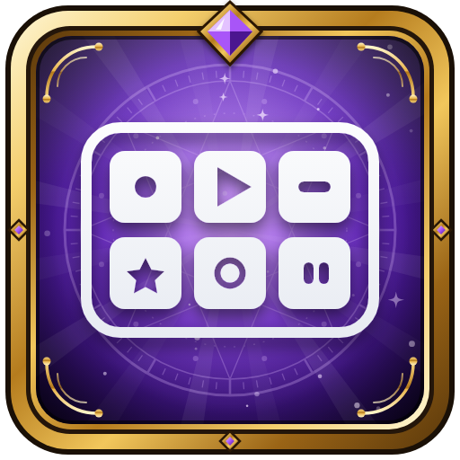
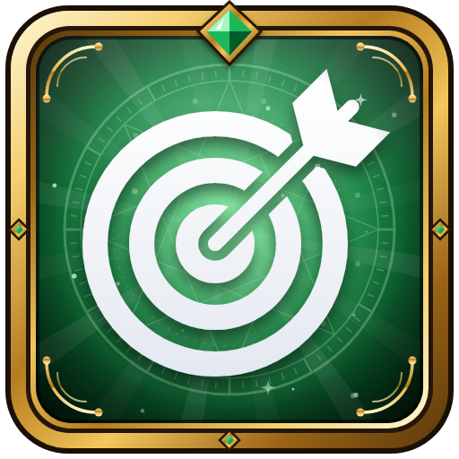
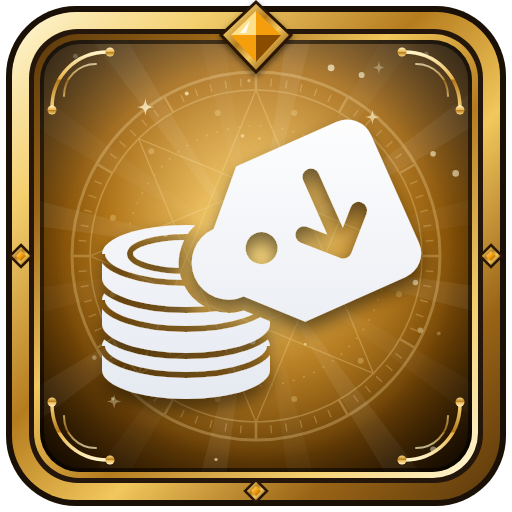
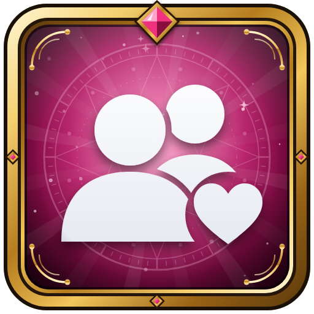
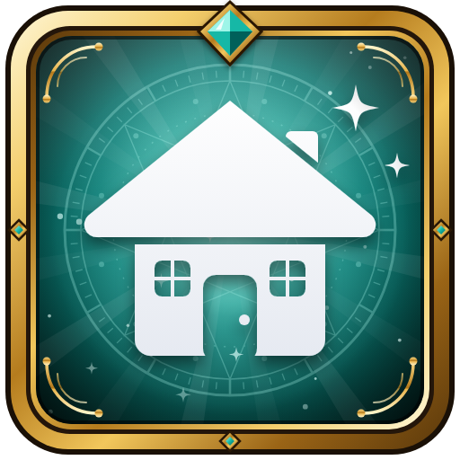
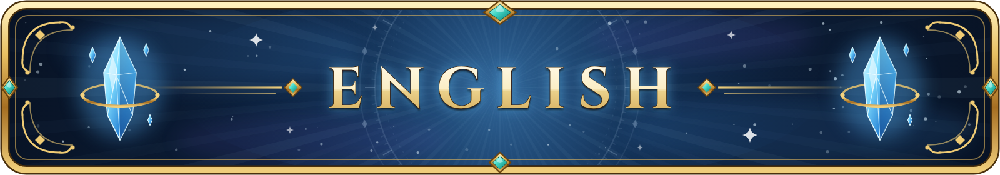

<p align="center"></p>

# EorzeaCore

Dalamud-Plugins für FINAL FANTASY XIV von D. Luuuffy.

Alle Plugins starten auf Deutsch und lassen sich auf Englisch umschalten - in den Einstellungen des Plugins oder per Befehl, z. B. `/ziele englisch`.

## So bekommst du die Plugins

1. Im Spiel `/xlsettings` öffnen und in den Reiter **Experimentell** wechseln.
2. Unter **Custom Plugin Repositories** diesen Link einfügen und auf **+** klicken:

   ```
   https://raw.githubusercontent.com/Dluuufffey/EorzeaCore/main/repo.json
   ```

3. Den Haken bei **Enabled** setzen und speichern.
4. Mit `/xlplugins` die Plugins suchen und installieren.

Updates kommen danach automatisch beim Einloggen (oder über „Aktualisieren“ im Plugin-Installer).

## Plugins

<table>
<tr>
<td width="80" align="center"></td><td><b>EorzeaCore&nbsp;-&#8288;&nbsp;Aggro&nbsp;Radar</b>&nbsp;<code>1.2.10</code><br>Immersives Tank-Plugin</td>
<td width="80" align="center"></td><td><b>EorzeaCore&nbsp;-&#8288;&nbsp;Chat</b>&nbsp;<code>1.9.6</code><br>Ersetzt den Spiel-Chat</td>
</tr>
<tr>
<td width="80" align="center"></td><td><b>EorzeaCore&nbsp;-&#8288;&nbsp;Moddeck</b>&nbsp;<code>1.6.5</code><br>Penumbra-Mods, Designs und Emotes per Knopfdruck</td>
<td width="80" align="center"></td><td><b>EorzeaCore&nbsp;-&#8288;&nbsp;Goals</b>&nbsp;<code>1.7.3</code><br>Raids, Dungeons, Quests und Stämme im Blick</td>
</tr>
<tr>
<td width="80" align="center"></td><td><b>EorzeaCore&nbsp;-&#8288;&nbsp;Inv&nbsp;Retainer</b>&nbsp;<code>1.9.5</code><br>Automatische Preise für deine Gehilfen</td>
<td width="80" align="center"></td><td><b>EorzeaCore&nbsp;-&#8288;&nbsp;Friends</b>&nbsp;<code>1.6.4</code><br>Deine Freundesliste in schön - Freunde leuchten auf der Minimap</td>
</tr>
<tr>
<td width="80" align="center"></td><td><b>EorzeaCore&nbsp;-&#8288;&nbsp;Housing&nbsp;Tracker</b>&nbsp;<code>1.7.5</code><br>Freie Grundstücke, Lotterie und Clubs mit Live-DJs</td>
<td width="80" align="center"></td><td><b>EorzeaCore&nbsp;-&#8288;&nbsp;Stream</b>&nbsp;<code>1.0.10</code><br>Videos gemeinsam auf einem Bildschirm in der Spielwelt schauen</td>
</tr>
</table>

<br>

<p align="center"></p>

# EorzeaCore

Dalamud plugins for FINAL FANTASY XIV by D. Luuuffy.

All plugins start in German and can be switched to English - in the plugin's settings or with its command, e.g. `/goals english`.

## How to get the plugins

1. Open `/xlsettings` in the game and switch to the **Experimental** tab.
2. Paste this link under **Custom Plugin Repositories** and click **+**:

   ```
   https://raw.githubusercontent.com/Dluuufffey/EorzeaCore/main/repo.json
   ```

3. Tick **Enabled** and save.
4. Search for the plugins with `/xlplugins` and install them.

Updates then arrive automatically when you log in (or via “Update” in the plugin installer).

## Plugins

<table>
<tr>
<td width="80" align="center"></td><td><b>EorzeaCore&nbsp;-&#8288;&nbsp;Aggro&nbsp;Radar</b>&nbsp;<code>1.2.10</code><br>Immersive tank plugin</td>
<td width="80" align="center"></td><td><b>EorzeaCore&nbsp;-&#8288;&nbsp;Chat</b>&nbsp;<code>1.9.6</code><br>Replaces the game chat</td>
</tr>
<tr>
<td width="80" align="center"></td><td><b>EorzeaCore&nbsp;-&#8288;&nbsp;Moddeck</b>&nbsp;<code>1.6.5</code><br>Penumbra mods, designs and emotes at the push of a button</td>
<td width="80" align="center"></td><td><b>EorzeaCore&nbsp;-&#8288;&nbsp;Goals</b>&nbsp;<code>1.7.3</code><br>Raids, dungeons, quests and allied societies at a glance</td>
</tr>
<tr>
<td width="80" align="center"></td><td><b>EorzeaCore&nbsp;-&#8288;&nbsp;Inv&nbsp;Retainer</b>&nbsp;<code>1.9.5</code><br>Automatic prices for your retainers</td>
<td width="80" align="center"></td><td><b>EorzeaCore&nbsp;-&#8288;&nbsp;Friends</b>&nbsp;<code>1.6.4</code><br>Your friend list, but beautiful - friends glow on the minimap</td>
</tr>
<tr>
<td width="80" align="center"></td><td><b>EorzeaCore&nbsp;-&#8288;&nbsp;Housing&nbsp;Tracker</b>&nbsp;<code>1.7.5</code><br>Free plots, lottery and clubs with live DJs</td>
<td width="80" align="center"></td><td><b>EorzeaCore&nbsp;-&#8288;&nbsp;Stream</b>&nbsp;<code>1.0.10</code><br>Watch videos together on a screen in the game world</td>
</tr>
</table>
